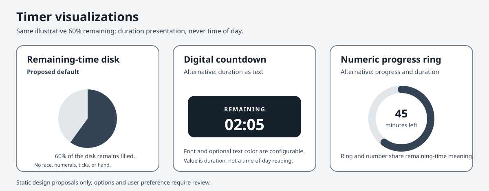

# Accessible screen flows and theme prototypes

| Field | Value |
|---|---|
| Document ID | M2-DOC-004 |
| Revision | 1.6 |
| Document owner | @Entreco |
| Author | Copilot; human accountability remains with the owner |
| Required reviewers | Product design, accessibility, and usability reviewers: unassigned |
| Approver | @Entreco, after required reviews and findings resolution |
| Related issue | [#23](https://github.com/Entreco/elchrono/issues/23) |
| Review PR | Prior baselines: [PR #28](https://github.com/Entreco/elchrono/pull/28) (revision 0.2), [PR #29](https://github.com/Entreco/elchrono/pull/29) (revision 1.3), and [PR #32](https://github.com/Entreco/elchrono/pull/32); revision 1.6: [PR #33](https://github.com/Entreco/elchrono/pull/33) |

Lifecycle status is derived from the branch and PR context, not stored in this
table. See [document controls](../governance/document-control.md#lifecycle-and-approval).

## Purpose and limits

This record proposes low-fidelity screen flows and three timer visualizations
for review. It is design evidence for the proposed ordinary-waiting use, not
application implementation, a usability finding, or approval of product
requirements. The current application remains a starter screen, not an
implemented timer.

An interactive, browser-based demonstration is available in the
[local demo](demo/README.md). It has one configurable countdown, defaulting to
two hours, and a single Shape selector: Clock (formerly Disk), Battery, Hand fan, or Ring.
The former digital circle is merged into Clock. Changing shape preserves
the countdown, shared background/foreground/text colors, font, and text
visibility. Ring thickness appears only for Ring and is retained when changing
shape. Show remaining independently controls the duration display. A Show
details slider steps through Off, then 2–12 equal sections, defaulting to six.
Details add duration-based labels outside Clock only, Ring section
boundaries, battery divisions, or fixed fan separators. Clock keeps a continuous
fill regardless of details; only its outer labels change. Ring details add no
intermediate text; Show remaining still controls its central duration. One hour with two
sections shows 0 and 30. Configured durations below ten minutes use whole seconds
(five minutes with twelve sections: 0, 275, 250, ..., 25 clockwise).
Durations of ten minutes or more use compact minutes rounded to one decimal,
omitting trailing zeros (thirty minutes with twelve sections: 0, 27.5, 25,
22.5, ..., 2.5). A single unit label below Clock is shown only with details.
Units do not change as the countdown runs.
The base fill remains visible. Shapes have no explanatory captions.
Font and text color controls appear when time
or Clock numerals are visible, without
clearing their values when hidden. Each shape uses only the selected colors;
unselected colors are not added as decorative highlights or outlines. The
disk's optional duration numerals use 36 px text outside its progress area, with
reserved space for the larger labels. Clock uses a radial remaining-time
treatment, Battery drains linearly, and the hand-fan
shape empties over 180 degrees toward a fixed left edge, like a disk sweep,
keeping its radius and separator positions fixed rather than folding them. The
optional disk numerals
are an exploratory client-feedback variant only; the product design remains
without clock-face numerals or markings. These are prototype controls only,
separate from the Kotlin application and not approved product requirements.
The prototype also permits duration selection from one minute through 24 hours
and hiding or showing its personalization panel; these controls do not
establish changed requirements.

The requirement IDs cited below are candidates from
[M2-DOC-001, revision 0.5](../product/requirements.md); they remain proposed
pending required review and approval. The risk IDs are proposed in
[M1-DOC-004, revision 0.5](../safety/risk-assessment.md); the related risk
controls are not verified. Intended-use and risk-assessment review gaps remain
open. This design does not establish medical-device qualification, legal
conformance, or certification.

## Design principles

- The timer visualization represents remaining duration, not a clock, time of
  day, deadline guarantee, or safety-critical timing system.
- Each visualization uses the same continuous remaining-time mapping: its
  complete form represents 100% of the configured duration remaining; its
  empty form represents zero. Static examples use the same illustrative 60%
  remaining.
- Progress has a non-colour cue: filled extent and remaining track are
  distinguishable by shape and position. State is also stated in text.
- The proposed theme presentation is visual-only. Accessible semantics expose
  a progress indicator named "Remaining waiting time" with a value from 0% to
  100% remaining, plus a separate textual timer state. Exact spoken wording
  and announcement cadence remain for accessibility/usability review; this
  record does not select an accessibility conformance baseline.
- No flashing, countdown animation, sound, or motion is proposed by these
  static drawings.
- The concepts do not establish user preference, a fixed number of themes, or
  which themes will be available in a release.
  This M2 review is limited to the designs and prototypes already documented
  here. It adds no new design or theme; future designs/themes are deferred to
  later versions and require their own usability review before selection.

## Screen flows

### Main screen and states

The running and paused examples retain the same illustrative progress shape.
The interrupted example retains the shape but explicitly warns that progress
may be out of date; it must not imply timing continuity when that is unknown.
No in-app volume control is included in v1. Opening Settings while running
pauses the countdown; saving valid settings starts a new countdown at the full
saved duration. Settings has no caregiver-protection mechanism in v1. No
interruption-recovery action is provided; an interrupted presentation must
not imply timing continuity. No separate manual pause, resume, or reset
controls are provided in v1; opening Settings is the selected pause behavior,
and saving valid Settings is the selected start/restart action.

| Main element | Proposed presentation and semantics | Requirement / risk links |
|---|---|---|
| Remaining progress | A theme's progress shape; accessible role: progress indicator; label: "Remaining waiting time"; value: percent of the configured duration remaining, 0-100. | REQ-003; RISK-001, RISK-005 |
| Running state | Text label "Running" separate from progress semantics. | REQ-003; RISK-001, RISK-005 |
| Paused state | Text label "Paused" separate from progress semantics. Opening Settings while running pauses the countdown. | REQ-002, REQ-003; RISK-001, RISK-005 |
| Interrupted state | Text label "Timer interrupted" and "Progress may be out of date"; no recovery is provided or promised in v1. | REQ-003; RISK-002, RISK-005 |
| Settings access | Settings is available without a caregiver-protection mechanism in v1. This is the product owner's explicit risk disposition, not a verified control; a patient may change the saved duration or theme. | REQ-005; RISK-004 |
| Settings lifecycle | Opening Settings while running pauses the countdown. Saving valid settings starts a new countdown from the full saved duration. | REQ-002; RISK-001 |
| Manual timer controls | No separate manual pause, resume, or reset controls are provided in v1. After Settings pauses a running timer, saving valid Settings starts a new countdown from the full saved duration. | REQ-002; RISK-001 |
| Volume and audio | No in-app volume control, music integration, or completion sound is included in v1. Music is deferred to v2 and its behavior requires separate review. | REQ-004, REQ-008, REQ-010; RISK-003 |
| Interrupted state | Display the interrupted warning when continuity is uncertain; no recovery behavior is provided or promised in v1. | REQ-003; RISK-002 |

At zero, REQ-010 returns immediately to the configured duration without a
completed screen or completed-state message. Music is not part of v1; if
introduced in v2, it will stop at zero. This candidate behavior remains subject
to review and approval.

### Settings screen

The duration entry example follows the candidate sequential-digit rule:
`205` displays as `02:05`. The configured duration is a whole-minute value
from 00:01 through 24:00. The examples describe field content, not a
verification result.

Requirements: REQ-001 (duration entry), REQ-002 (no separate manual timer
controls, save-to-start, and Settings-open pause), REQ-004 (screen content), REQ-005 (v1 access decision),
and REQ-006 (theme selection). Optional music is deferred to v2.

The v1 flow has no caregiver-only access gate: Settings can be opened without
protection. The user configures duration and visualization, then saves; saving
starts a new countdown from the full saved duration. Opening Settings while
the countdown is running pauses it. No separate manual pause, resume, or reset
control is provided; valid Save is the only selected action that starts or
restarts the timer. The proposed initial visualization is a Time Timer-inspired
remaining-time disk. This adapts the supplied dial-like reference to the
no-clock requirement: it has no clock face, numerals, tick marks, or hand. It
is a design proposal, not a selected or approved product default. A caregiver
or patient can access Settings in v1; saving valid settings is the timer-start
action under REQ-002.

The appearance controls are conditional on the selected visualization. Offer
a font choice only when it displays text, and a color choice only when it uses
color. These are proposed settings, scoped to the selected
visualization; available choices, defaults, saving/persistence, and any
reset-to-default action remain undecided. Any selected font or color must
preserve readable text, non-colour progress/state cues, and the same remaining
time semantics. Contrast and legibility need accessibility and usability
review; no conformance baseline or user preference is claimed.

There is no music area or audio control in the v1 Settings design. Music
integration is deferred to v2. Provider, connection, playback controls, start
behavior, volume controls/limits, completion sounds, and audio-failure
presentation are not decided for v2 and require later product, provider,
platform, and usability review.

### About screen

The About portion of the prototype reserves space for the company logo,
version/build details, support information, privacy policy, relevant licences,
intended use, and limitations, as required by REQ-004. Unknown content is
explicitly marked for its owner to supply; no logo asset, contact details,
policy, licence list, or build value is fabricated here.

Requirements: REQ-004 (About content) and REQ-009 (non-medical claims boundary).

The proposed intended-use and limitation copy is restricted to ordinary
waiting-time support and says the app is not a clock or for medical or
safety-critical timing. It does not claim a clinical benefit or guarantee that
a wait has ended. The About entry point and navigation placement remain
unselected.

## Timer visualizations

| Visualization | Visual treatment | Remaining-time mapping | Requirement / risk links |
|---|---|---|---|
| Time Timer-inspired remaining disk (proposed default) | A filled disk sector shrinks as time elapses. No dial, face, numeral, tick mark, or hand is shown; the nearby "Remaining" label makes the duration meaning explicit. | Full disk means 100% remains; empty disk means zero. | REQ-003, REQ-006; RISK-001, RISK-005 |
| Digital duration countdown | Prominent remaining duration (illustrated as `02:05`) with a textual "Remaining" label; it is not time of day. Font and, if used, text color are configurable proposals. | The duration value counts down; optional progress indication follows the same remaining-time fraction. Units and display precision require review. | REQ-003, REQ-006; RISK-001, RISK-005 |
| Numeric circular progress | Circular progress ring with a central remaining-duration value (illustrated as `45 min`); no dial markings or hands. | Ring fill and numeric duration both represent time remaining; their mapping must stay consistent. | REQ-003, REQ-006; RISK-001, RISK-005 |

The remaining disk is the proposed first/default visualization; digital
countdown and numeric circular progress are alternatives inspired by the
references supplied for this review. All three are unselected design proposals
pending review, not a prescribed final theme count or a claim that any is
preferred or usable by a representative patient. Their shared mapping is a
design constraint; it has not been implemented or verified across durations,
screen sizes, platforms, or assistive technology. The attached references
inform the concepts but are not copied into the repository.

The local demo makes these concepts interactive without establishing
requirements or product behavior. Its configurable countdown runs from a user
action, uses the browser monotonic clock, and immediately resets to the chosen
duration at completion without a completed state. Shape switching does not reset
countdown progress. It does not implement pause, restart controls, persistence,
audio, or interruption recovery. Styling previews are shared across shapes for
the current page session only; nothing is saved across reloads.

## Product decisions and evidence gaps

The following product decisions define the current v1 proposal. They do not
establish competent risk review, design approval, or verification:

| Decision | Design boundary |
|---|---|
| D-01: caregiver protection mechanism | Product owner accepts unprotected Settings for v1; the design shows no access gate. RISK-004 acceptability remains subject to competent review; no control effectiveness is claimed. |
| D-02: volume controls and limits | No in-app volume controls in v1. Reassess audio/volume requirements if a later version adds music. |
| D-03: music and audio behavior | Music is deferred to v2. No music start behavior or completion sound is included in v1; future audio behavior remains undecided. |
| D-04: timer start and Settings lifecycle | Saving valid settings starts a new countdown from the full saved duration; opening Settings while running pauses it. |
| D-05: interruption recovery | No recovery behavior is provided or promised in v1. Retain the interrupted-state warning and never imply timing continuity when uncertain. |
| D-06: manual pause, resume, and reset controls | No separate controls are provided in v1. Settings-open is the selected pause behavior; saving valid Settings is the only selected start/restart action and starts from the full saved duration. |
| Visualization appearance | Font and color are proposed as conditional per-visualization settings; option lists, defaults, and persistence remain undecided and require accessibility/usability review. |

Required product-design, accessibility, usability, and specialist review
appointments remain unassigned. No caregiver or representative-patient review
of these revised decisions, design approval, or requirement approval is
claimed. The static SVGs remain non-interactive; the browser demo provides
interactive view switching but has not been tested for screen readers,
keyboard, touch, or any target platform. Record actual reviewer scopes,
feedback, findings, and dispositions in the review PR; keep unresolved findings
and limitations explicit.

## Revision history

| Revision | Change |
|---|---|
| 0.1 | Establish candidate screen flows and three low-fidelity theme concepts for issue #23; preserve open decisions and review gaps. |
| 0.2 | Propose a Time Timer-inspired remaining disk as the first/default visualization and digital and numeric-ring alternatives; add conditional per-visualization font/color settings while preserving no-clock and open-decision constraints. |
| 0.3 | Add a local interactive two-hour browser demo of the three visualizations and per-view appearance previews; keep it separate from the application and product requirements. |
| 0.4 | Refine the demo with a reversed disk sweep, visualization-colored digital background, and adjustable numeric-ring thickness; keep these prototype-only and preserve the no-clock boundary. |
| 0.5 | Add prototype-only background-color and number-visibility options, a draining digital fill, and optional clock-position disk numerals for feedback; retain the product no-clock boundary. |
| 0.6 | Add configurable demo duration, a hide/show personalization control, and a ring-thickness range from hairline to solid fill. |
| 0.7 | Apply the selected background to the disk's center and depleted area; place digital time inside its shape; add battery/circle/half-circle shapes and four background presets. |
| 0.8 | Separate background, foreground, and text color controls and limit each visualization to those three selected colors. |
| 0.9 | Place optional disk numerals outside the progress area; make the digital circle drain radially and the hand fan fold closed with elapsed time. |
| 1.0 | Triple optional disk numeral size to 36 px with surrounding space; replace horizontal fan scaling with a fixed-radius angular opening from 180 degrees to zero. |
| 1.1 | Unify the demo into one shape selector and shared settings; merge Circle into Disk; retain hidden text preferences and ring thickness across shape changes. |
| 1.2 | Separate remaining-time visibility from shape-specific progress markers; add ring numerals and battery divisions; replace fan folding with a fixed-edge sweep and clipped stationary separators. |
| 1.3 | Replace Show progress with an Off/2–12-section Show details slider; subdivide Battery/Fan/Ring, keep Clock fill continuous, and label Clock only; remove shape explanations. Rename prototype Disk to Clock and use seconds below ten configured minutes, compact decimal minutes otherwise, with one unit label; no time-of-day display or product-boundary change. |
| 1.4 | Align the proposed Main and Settings flows with v1 decisions: no caregiver gate or volume/music controls, saving settings starts a full-duration countdown, opening Settings pauses it, and interruption recovery is not provided. |
| 1.5 | Update the linked risk-assessment source revision to 0.5; preserve the v1 product decisions and pending risk/design review. |
| 1.6 | Record the v1 decision to omit separate manual pause, resume, and reset controls; the existing prototype designs remain the review scope. |
