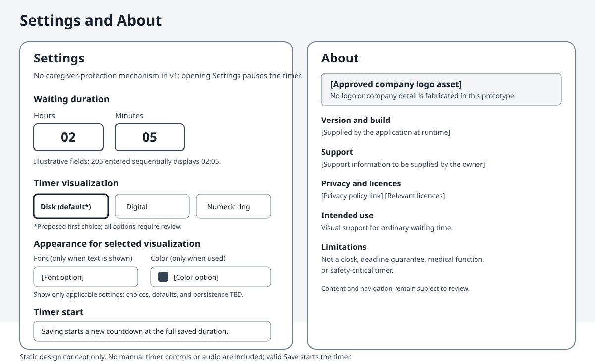

# Accessible screen flows and theme prototypes

Desktop keyboard changes: [PR #73](https://github.com/Entreco/elchrono/pull/73).

| Field | Value |
|---|---|
| Document ID | M2-DOC-004 |
| Revision | 2.4 |
| Document owner | @Entreco |
| Author | Copilot; human accountability remains with the owner |
| Required reviewers | Product design, accessibility, and usability: @Entreco, designated by the product owner; exact-revision acceptance and findings disposition are recorded in the review PR |
| Approver | @Entreco, after required reviews and findings resolution |
| Related issue | [#23](https://github.com/Entreco/elchrono/issues/23) |
| Review PR | Prior baselines: [PR #28](https://github.com/Entreco/elchrono/pull/28) (revision 0.2), [PR #29](https://github.com/Entreco/elchrono/pull/29) (revision 1.3), and [PR #32](https://github.com/Entreco/elchrono/pull/32); revision 1.6: [PR #41](https://github.com/Entreco/elchrono/pull/41); #47 update: [PR #59](https://github.com/Entreco/elchrono/pull/59); #67: [PR #68](https://github.com/Entreco/elchrono/pull/68); #66 review: [draft PR #70](https://github.com/Entreco/elchrono/pull/70); final exact-head acceptance pending |

Lifecycle status is derived from the branch and PR context, not stored in this
table. See [document controls](../governance/document-control.md#lifecycle-and-approval).

## Purpose and limits

This record defines screen flows and the four timer visualizations approved by
the product owner for the v1 theme selector: Clock, Battery, Fan, and Ring.
The owner's decision on 2026-11-19 approves the visualizations as presented in
the local demo and selects Clock as the demo-matching initial theme; this is
not a claim of representative-user preference. The shared shell, Settings,
and About implementations are merged through #47, #65, and #67. Issue #66
completes the browser Timer candidate; no M5 usability validation or platform
support is established by implementation or compilation.

An interactive, browser-based demonstration is available in the
[local demo](demo/README.md). It has one configurable countdown, defaulting to
two hours, and a single Shape selector: Clock (formerly Disk), Battery, Hand fan, or Ring.
The former digital circle is merged into Clock. Changing shape preserves
the countdown, shared background/foreground/text colors, font, and text
visibility. Ring thickness appears only for Ring and is retained when changing
shape. Show remaining independently controls the duration display. A Show
details slider steps through Off, then 2–12 equal sections, defaulting to six.
Details add duration-based labels outside Clock only, Ring section
boundaries, battery divisions, or fixed fan separators. Clock keeps a continuous
fill regardless of details; only its outer labels change. Ring details add no
intermediate text; Show remaining still controls its central duration. One hour with two
sections shows 0 and 30. Configured durations below ten minutes use whole seconds
(five minutes with twelve sections: 0, 275, 250, ..., 25 clockwise).
Durations of ten minutes or more use compact minutes rounded to one decimal,
omitting trailing zeros (thirty minutes with twelve sections: 0, 27.5, 25,
22.5, ..., 2.5). A single unit label below Clock is shown only with details.
Units do not change as the countdown runs.
The base fill remains visible. Shapes have no explanatory captions.
Font and text color controls appear when time
or Clock numerals are visible, without
clearing their values when hidden. Each shape uses only the selected colors;
unselected colors are not added as decorative highlights or outlines. The
disk's optional duration numerals use 36 px text outside its progress area, with
reserved space for the larger labels. Clock uses a radial remaining-time
treatment, Battery drains linearly, and the hand-fan
shape empties over 180 degrees toward a fixed left edge, like a disk sweep,
keeping its radius and separator positions fixed rather than folding them. The
optional disk numerals
are an exploratory client-feedback variant only; the product design remains
without clock-face numerals or markings. These are prototype controls only,
separate from the Kotlin application and not approved product requirements.
The prototype also permits duration selection from one minute through 24 hours
and hiding or showing its personalization panel; these controls do not
establish changed requirements.

The requirement IDs cited below are from
[M2-DOC-001](../product/requirements.md); implementation and verification
status is in [M2-DOC-003](../safety/requirements-traceability-matrix.md).
The risk IDs are from [M1-DOC-004](../safety/risk-assessment.md); related
controls are not verified and risk disposition is recorded separately. This
design does not establish medical-device qualification, legal conformance, or
certification.

## Design principles

- The timer visualization represents remaining duration, not a clock, time of
  day, deadline guarantee, or safety-critical timing system.
- Each visualization uses the same continuous remaining-time mapping: its
  complete form represents 100% of the configured duration remaining; its
  empty form represents zero. Static examples use the same illustrative 60%
  remaining.
- Progress has a non-colour cue: filled extent and remaining track are
  distinguishable by shape and position. State labels and an interruption
  warning appear at detail 1-12; detail 0 uses distinct visual cues and
  accessible state descriptions instead of any on-screen timer text.
- At detail 0, running, paused, interrupted, and idle states use a play
  triangle, pause bars, an outlined warning triangle, and an empty circle,
  respectively. The interrupted accessible description says that progress
  may be out of date. This is the issue #66 implementation candidate, not an
  approved usability design; review of the revised warning remains pending.
- For non-idle timers, accessible semantics expose a progress indicator named
  "Remaining waiting time" with a value from 0% to 100% remaining. The
  zero-duration idle state is described as not counting and not completed,
  rather than as a 0%-remaining countdown. Exact spoken wording and
  announcement cadence remain for accessibility/usability review; this record
  does not select an accessibility conformance baseline.
- No flashing, countdown animation, sound, or motion is proposed by these
  static drawings.
- The product owner selected the four shapes already in the demo for the v1
  theme selector: Clock, Battery, Fan, and Ring. This is a product/design
  decision, not a claim that users prefer one shape or that all intended users
  can use each shape successfully.
- Application font, colors, detail, and Ring thickness are now specified by
  REQ-012. Demo-only independent visibility controls remain exploratory.
  A control's inclusion does not establish usability or accessibility.
- Android TV and Apple TV are primary project targets. This visual design
  source does not establish remote/D-pad focus behavior, viewing-distance
  typography, TV layout limits, or platform support; those require target-
  specific design and verification. Wear OS and watchOS are outside v1 scope.

## Screen flows

### Main screen and states

The running and paused examples retain the same illustrative progress shape.
The interrupted example retains the shape but explicitly warns at detail 1-12
that progress may be out of date; at detail 0, an outlined warning cue and an
accessible stale-progress description replace all on-screen Timer text. It
must not imply timing continuity when that is unknown.
In the browser MVP, a hidden-page or page-hide event is recorded and the timer
is paused on the next timer update after the page returns. The interrupted
warning remains until valid Settings are saved; Save starts a fresh countdown
from the full configured duration. No automatic recovery is provided.
No in-app volume control is included in v1. Opening Settings while running
pauses the countdown; saving valid settings starts a new countdown at the full
saved duration. Settings has no caregiver-protection mechanism in v1. No
interruption-recovery action is provided; an interrupted presentation must
not imply timing continuity. No separate manual pause, resume, or reset
controls are provided in v1; opening Settings is the selected pause behavior,
and saving valid Settings is the selected start/restart action.

| Main element | Proposed presentation and semantics | Requirement / risk links |
|---|---|---|
| Remaining progress | A theme's progress shape; accessible role: progress indicator; label: "Remaining waiting time"; value: percent of the configured duration remaining, 0-100. At idle 00:00, expose an idle/not-completed description without a countdown progress value. | REQ-002, REQ-003; RISK-001, RISK-005 |
| Running state | Text label "Running" at detail 1-12; a play-triangle cue and accessible running description at detail 0. | REQ-003, REQ-013; RISK-001, RISK-005 |
| Paused state | Text label "Paused" at detail 1-12; pause bars and an accessible paused description at detail 0. Opening Settings while running pauses the countdown. | REQ-002, REQ-003, REQ-013; RISK-001, RISK-005 |
| Interrupted state | At detail 1-12, show "Timer interrupted" and "Progress may be out of date"; at detail 0, show a warning-triangle cue and accessible stale-progress description, without on-screen Timer text. The browser MVP pauses after a detected hidden-page/page-hide event and does not automatically resume. Valid Settings changes start a fresh countdown. | REQ-003, REQ-013; RISK-002, RISK-005 |
| Idle state | 00:00 remains non-counting and non-animating with an empty base shape; the idle cue and accessible description do not represent a completed countdown. At detail 0, no on-screen Timer text is shown. | REQ-002, REQ-013; RISK-001, RISK-005 |
| Settings access | Settings is available without a caregiver-protection mechanism in v1. This is the product owner's explicit risk disposition, not a verified control; a patient may change the saved duration or theme. | REQ-005; RISK-004 |
| Settings lifecycle | Opening Settings while running pauses the countdown. Saving valid settings starts a new countdown from the full saved duration. | REQ-002; RISK-001 |
| Manual timer controls | No separate manual pause, resume, or reset controls are provided in v1. After Settings pauses a running timer, saving valid Settings starts a new countdown from the full saved duration. | REQ-002; RISK-001 |
| Volume and audio | No in-app volume control, music integration, or completion sound is included in v1. Music is deferred to v2 and its behavior requires separate review. | REQ-004, REQ-008, REQ-010; RISK-003 |
| Interrupted state | Display the interrupted warning when continuity is uncertain; no recovery behavior is provided or promised in v1. | REQ-003; RISK-002 |

At nonzero completion, REQ-010 returns immediately to the configured duration
without a completed screen or completed-state message. A configured 00:00
duration is idle, does not count down or animate, and is not a completed
countdown. Music is not part of v1; if introduced in v2, it will stop at zero.
This candidate behavior remains subject to review and approval.

### M5 Timer scope and detail mapping

Issue #66 completes the Timer screen for the browser MVP only. The visualization
uses the full available feature area and preserves one continuous remaining-
time fraction across Clock, Battery, Fan, and Ring. Clock's remaining arc starts
at 12 when full; as time elapses, its leading edge moves clockwise to the
right. Clock detail N shows N duration labels evenly around the disk and never
adds segment boundaries; for a one-hour configured duration and detail 2, the
labels are 0 at the top and 30 at the bottom. Durations below ten minutes use
whole-second labels; longer durations use compact minute values rounded to one
decimal with trailing zeros omitted. One localized unit label appears below
Clock only while details are shown. Battery uses vertical dividers, Fan uses
radial fan-blade dividers, and Ring uses dividers across its stroke. At detail N
from 2 through 12, N-1 equal boundaries form N segments; detail 1 is one
continuous, undivided segment. Detail 0 has no extra boundaries or Clock labels.
The application Fan is a centered, fully visible upper semicircle; its remaining
sector and stationary radial dividers follow the demo's sweep and clipping.

At detail 0, all on-screen Timer text is absent, including remaining time,
theme/state labels, and the interrupted warning. Non-text state cues remain
visible and screen-reader descriptions identify the state; interruption
explicitly communicates that progress may be out of date. These cues and the
changed warning presentation remain subject to human design, accessibility,
usability, and risk review. The feature adds no countdown animation; elapsed
time continues to come from the monotonic timer engine. The selected background
color fills the Timer content surface and depleted visualization; the
foreground color represents remaining time, and the text color is used for
labels and state cues. A bounded headless Chrome render check observed the idle
screen at 320 × 640 and 1440 × 1000, plus running Clock and Fan presentations at
both viewports with a two-hour duration and detail 6. The Clock showed six
duration labels around a continuous disk with no internal boundaries; the Fan
semicircle and visible dividers fit within its available visualization area.
This is not full responsive acceptance; other details, states, reduced-motion,
screen-reader, and human review remain verification work.

### Settings screen

The duration entry example follows the candidate sequential-digit rule:
`205` displays as `02:05`. The configured duration is a whole-minute value
from 00:00 through 24:00. The examples describe field content, not a
verification result.

Requirements: REQ-001 (duration entry), REQ-002 (no separate manual timer
controls, save-to-start, and Settings-open pause), REQ-004 (screen content), REQ-005 (v1 access decision),
and REQ-006 (theme selection). Optional music is deferred to v2.

When the window can support multiple panes, Settings appears in a supporting
side pane while the Timer remains the main pane. On compact windows, Settings
is the single visible destination and remains reachable through the shell
controls. Mobile targets accept sequential digits from the system keyboard
when available and show the reusable numeric keypad as a fallback. Desktop
uses physical-keyboard entry without the app keypad. Browser and TV use the
keypad without keyboard-based duration entry; TV support is not established.
These flows preserve `205` as `02:05`; layout, input, focus,
accessibility, and no-clipping behavior remain unverified.

The v1 flow has no caregiver-only access gate: Settings can be opened without
protection. The user configures duration and visualization; valid changes
preview immediately and are saved automatically, without a Save action.
The full app-owned area uses the selected background, including app bars,
pane gutters, and About. Settings uses an 8% contrasting tint over that
background, without a required blur. Controls use light/dark design colors
chosen for the background; patient visualization text still uses its selected
text color without enforcing contrast restrictions.
While Settings is open, a separate presentation snapshot uses the full selected
duration and a paused/idle presentation. Clock labels, units, remaining text,
and fill update together without altering the underlying paused engine.
Invalid drafts keep the last valid preview with an input error. Previewing
does not clear an underlying interruption; closing Settings starts anew.
Closing Settings starts a fresh countdown from the full configured duration.
At 00:00, the Timer remains non-counting and non-animating. The duration entry starts
at 02:00, matching the demo; this is an initial field value, not saved
preference. Clock is initially selected, also matching the demo. Opening Settings while
the countdown is running pauses it. No separate manual pause, resume, or reset
control is provided; valid Save is the only selected action that starts or
restarts the timer. A caregiver or patient can access Settings in v1; saving
valid settings is the timer-start action under REQ-002.

The appearance controls are conditional on the selected visualization. Offer
a font choice only when it displays text, and a color choice only when it uses
color. These are proposed settings, scoped to the selected
visualization; available choices, defaults, saving/persistence, and any
reset-to-default action remain undecided. Any selected font or color must
preserve readable text, non-colour progress/state cues, and the same remaining
time semantics. Contrast and legibility need accessibility and usability
review; no conformance baseline or user preference is claimed.

There is no music area or audio control in the v1 Settings design. Music
integration is deferred to v2. Provider, connection, playback controls, start
behavior, volume controls/limits, completion sounds, and audio-failure
presentation are not decided for v2 and require later product, provider,
platform, and usability review.

### About screen

The About presentation includes the owner-supplied Entreco logo as a Compose
resource, displayed with fit scaling and accessible branding text. It groups
the app identity and required information into readable sections and uses the
existing Settings → About → Settings navigation in the shared shell. It is
shown in the shell's supporting pane when available and as a reachable
single-pane destination on compact windows; actual rendered layouts and
screen-reader behavior remain unverified.

The version/build value, support information, privacy policy, and relevant
licences have no authoritative source in the repository or supplied inputs.
The UI identifies each as unavailable instead of inventing details or
presenting dead links. These explicit gaps are not substitutes for the content
required by REQ-004, and they block a complete About screen. The product owner
must provide the actual version/build source and approved support, privacy, and
licence information before this requirement can pass.

The intended-use and limitations text is sourced from the project product
boundary and is limited to ordinary waiting-time support. It does not claim
medical use, clock or time-of-day display, deadline assurance, or
safety-critical timing. Human design, usability, and accessibility review
remain pending; the implementation does not establish user preference or
verification.

Requirements: REQ-004 (About content) and REQ-009 (non-medical claims boundary).

The proposed intended-use and limitation copy is restricted to ordinary
waiting-time support and says the app is not a clock or for medical or
safety-critical timing. It does not claim a clinical benefit or guarantee that
a wait has ended. The browser MVP exposes Main, Settings, and About in its
primary navigation. The browser implementation explicitly identifies missing
owned content as not provided; it does not fabricate a logo, build value,
support contact, privacy policy, or licence list.

## Timer visualizations

Issue #66's latest candidate reserves equal top/bottom decoration space
independently of detail. Text is overlaid in those bounded regions, scrollable
when short windows or larger fonts require it. Base geometry does not depend
on decoration visibility. Clock reserves one duration/font-aware envelope for
all label counts, including when labels are hidden. The existing detail-0
status cue is non-interactive and sits at the bottom-right of the Timer pane.

Battery matches the demo's shallow horizontal body, foreground outline,
inset clipped fill, and external foreground terminal. Preferred body height
is capped at 126 logical pixels; narrow/short layouts shrink it to fit while
wider layouts may stretch horizontally. The complete silhouette is centered.
Ring thickness is a normalized 1-100% of outer radius, default 24% to preserve
the prior nominal appearance, not the demo's pixel default. Its outer radius
stays fixed, track/progress share a centerline, and 100% uses a filled sector
rather than an overlapping thick stroke. Thickness survives shape changes
and storage reopen; legacy settings get the default without losing selections.
These designs require final human review; no new preference evidence is claimed.

The approved demo presents the four v1 choices: Clock, Battery, Fan, and Ring.
The separate [interactive demo](demo/README.md) is the visual reference.

| Visualization | Visual treatment | Remaining-time mapping | Requirement / risk links |
|---|---|---|---|
| Clock | A remaining-time disk sector whose leading edge starts at 12 and moves clockwise to the right as time elapses. Detail N adds N evenly spaced duration labels outside the disk and no segment boundaries; for a one-hour duration at detail 2, labels are 0 at the top and 30 at the bottom. Durations below ten minutes use whole seconds; longer durations use compact minutes and a unit label. No clock face, hands, or time-of-day markings. | The filled sector represents the fraction remaining; full is 100%, empty is zero. | REQ-003, REQ-006, REQ-013; RISK-001, RISK-005 |
| Battery | A rectangular fill drains linearly inside a terminal battery shape; N-1 vertical boundaries divide N equal segments. No battery percentage or charge claim. | Filled extent represents the same fraction remaining as Clock. | REQ-003, REQ-006, REQ-013; RISK-001, RISK-005 |
| Fan | A centered, fully visible, fixed-radius upper semicircle; the filled 180-degree sector empties toward its fixed edge. N-1 stationary radial fan-blade boundaries divide N equal segments and are visible only within the remaining sector. | Filled sector represents the same fraction remaining as Clock. | REQ-003, REQ-006, REQ-013; RISK-001, RISK-005 |
| Ring | A circular stroke depletes around a fixed track; N-1 boundaries across its stroke divide N equal segments. Remaining duration may be shown separately at detail 1-12. | Stroke extent represents the same fraction remaining as Clock. | REQ-003, REQ-006, REQ-013; RISK-001, RISK-005 |

These are the v1 theme choices approved by the product owner, not a claim that
any shape is preferred or usable by every intended user. Their shared mapping
is a design constraint; it has not been verified across the application,
durations, layouts, platforms, or assistive technology. The interactive demo
is the visual reference for these four shapes, not a substitute for application
verification or TV-specific remote/focus design.

The local demo makes these shapes interactive without establishing
requirements or product behavior. Its configurable countdown runs from a user
action, uses the browser monotonic clock, and immediately resets to the chosen
duration at completion without a completed state. Shape switching does not reset
countdown progress. It does not implement pause, restart controls, persistence,
audio, or interruption recovery. Styling previews are shared across shapes for
the current page session only; nothing is saved across reloads.

## Product decisions and evidence gaps

The following product decisions define the current v1 proposal. They do not
establish competent risk review, design approval, or verification:

| Decision | Design boundary |
|---|---|
| D-01: caregiver protection mechanism | Product owner accepts unprotected Settings for v1; the design shows no access gate. RISK-004 acceptability remains subject to competent review; no control effectiveness is claimed. |
| D-02: volume controls and limits | No in-app volume controls in v1. Reassess audio/volume requirements if a later version adds music. |
| D-03: music and audio behavior | Music is deferred to v2. No music start behavior or completion sound is included in v1; future audio behavior remains undecided. |
| D-04: timer start and Settings lifecycle | Saving valid settings starts a new countdown from the full saved duration; opening Settings while running pauses it. |
| D-10: text-free detail 0 | Issue #66 requires all on-screen Timer text to be hidden at detail 0, including the interrupted warning; use distinct visual state cues and accessible stale-progress descriptions. The revised warning design has not received human review or usability validation. |
| D-05: interruption recovery | No recovery behavior is provided or promised in v1. Retain the interrupted-state warning and never imply timing continuity when uncertain. |
| D-06: manual pause, resume, and reset controls | No separate controls are provided in v1. Settings-open is the selected pause behavior; saving valid Settings is the only selected start/restart action and starts from the full saved duration. |
| D-09: adaptive Settings and duration input | Use Settings as a supporting side pane when the window supports multiple panes, with a reachable compact destination. Mobile uses available system keyboard input and falls back to the shared keypad; desktop uses keyboard entry without the app keypad; browser and TV use the keypad without keyboard-based duration entry. TV support is not established. |
| Visualization appearance | Font and color are proposed as conditional per-visualization settings; option lists, defaults, and persistence remain undecided and require accessibility/usability review. |

The product owner approved the four demo visualizations for the v1 design.
That decision does not close retrospective-evidence gaps or establish usability
for caregivers, representative patients, assistive technologies, keyboard,
touch, Android TV remote/D-pad, Apple TV focus, or any target platform. The
static SVGs remain non-interactive. Record exact reviewer scope, findings,
dispositions, limitations, and human acceptance of this revision in its review
PR.

## Revision history

| Revision | Change |
|---|---|
| 0.1 | Establish candidate screen flows and three low-fidelity theme concepts for issue #23; preserve open decisions and review gaps. |
| 0.2 | Propose a Time Timer-inspired remaining disk as the first/default visualization and digital and numeric-ring alternatives; add conditional per-visualization font/color settings while preserving no-clock and open-decision constraints. |
| 0.3 | Add a local interactive two-hour browser demo of the three visualizations and per-view appearance previews; keep it separate from the application and product requirements. |
| 0.4 | Refine the demo with a reversed disk sweep, visualization-colored digital background, and adjustable numeric-ring thickness; keep these prototype-only and preserve the no-clock boundary. |
| 0.5 | Add prototype-only background-color and number-visibility options, a draining digital fill, and optional clock-position disk numerals for feedback; retain the product no-clock boundary. |
| 0.6 | Add configurable demo duration, a hide/show personalization control, and a ring-thickness range from hairline to solid fill. |
| 0.7 | Apply the selected background to the disk's center and depleted area; place digital time inside its shape; add battery/circle/half-circle shapes and four background presets. |
| 0.8 | Separate background, foreground, and text color controls and limit each visualization to those three selected colors. |
| 0.9 | Place optional disk numerals outside the progress area; make the digital circle drain radially and the hand fan fold closed with elapsed time. |
| 1.0 | Triple optional disk numeral size to 36 px with surrounding space; replace horizontal fan scaling with a fixed-radius angular opening from 180 degrees to zero. |
| 1.1 | Unify the demo into one shape selector and shared settings; merge Circle into Disk; retain hidden text preferences and ring thickness across shape changes. |
| 1.2 | Separate remaining-time visibility from shape-specific progress markers; add ring numerals and battery divisions; replace fan folding with a fixed-edge sweep and clipped stationary separators. |
| 1.3 | Replace Show progress with an Off/2–12-section Show details slider; subdivide Battery/Fan/Ring, keep Clock fill continuous, and label Clock only; remove shape explanations. Rename prototype Disk to Clock and use seconds below ten configured minutes, compact decimal minutes otherwise, with one unit label; no time-of-day display or product-boundary change. |
| 1.4 | Align the proposed Main and Settings flows with v1 decisions: no caregiver gate or volume/music controls, saving settings starts a full-duration countdown, opening Settings pauses it, and interruption recovery is not provided. |
| 1.5 | Update the linked risk-assessment source revision to 0.5; preserve the v1 product decisions and pending risk/design review. |
| 1.6 | Record the v1 decision to omit separate manual pause, resume, and reset controls; the existing prototype designs remain the review scope. |
| 1.7 | Record the product owner's approval of the four demo visualizations (Clock, Battery, Fan, Ring) for the v1 theme set; distinguish that decision from user preference and validation, and add TV-target interaction/layout limitations. |
| 1.8 | Record the supporting-pane Settings flow and target-specific keyboard/keypad policy; preserve usability, accessibility, layout, and platform verification limitations. |
| 1.9 | Record the About implementation candidate, owner-supplied logo resource, explicit unavailable-content gaps, intended-use boundary, and outstanding product/design/accessibility verification. |
| 2.0 | Define issue #66's adaptive Timer scope, level-0 visual/accessibility cues, exact detail segment mapping and clockwise Clock depletion; retain human design/usability/risk review and browser verification gaps. |
| 2.1 | Record Timer surface-color behavior and the bounded headless browser render observation; keep full visual, accessibility, reduced-motion, and human reviews pending. |
| 2.2 | Align application Clock detail with the demo's outer duration labels and units instead of concentric bands; specify centered, unclipped Fan geometry and retain human review and verification gaps. |
| 2.3 | Specify global background, translucent Settings, immediate duration preview, bottom-right status cue, shallow Battery, stable detail overlays, and normalized Ring thickness; retain review gaps. |
| 2.4 | Describe desktop keyboard entry without the app keypad; retain physical-device, accessibility, and layout review gaps. |
