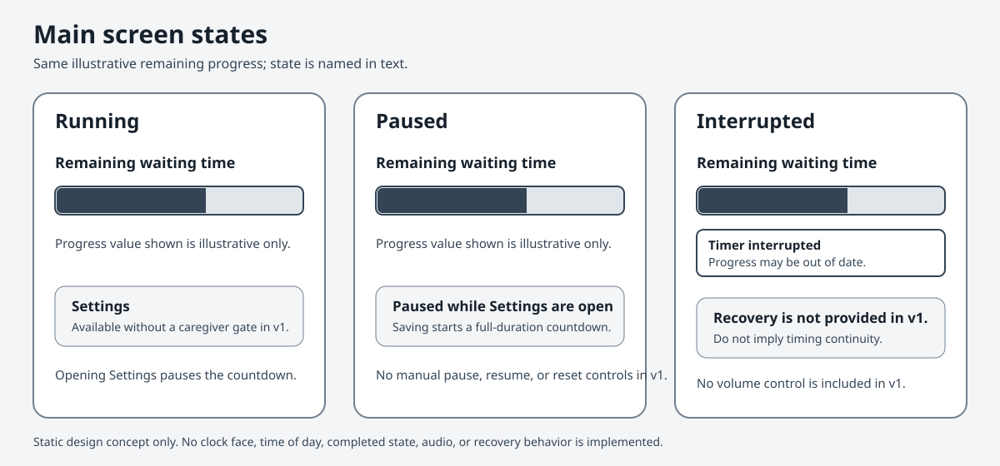
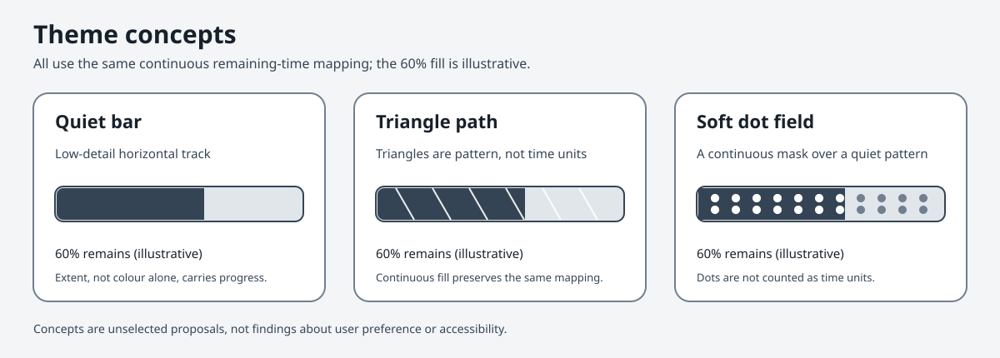

# Accessible screen flows and theme prototypes

| Field | Value |
|---|---|
| Document ID | M2-DOC-004 |
| Revision | 0.1 |
| Document owner | @Entreco |
| Author | Copilot; human accountability remains with the owner |
| Required reviewers | Product design, accessibility, and usability reviewers: unassigned |
| Approver | @Entreco, after required reviews and findings resolution |
| Related issue | [#23](https://github.com/Entreco/elchrono/issues/23) |
| Review PR | [PR #28](https://github.com/Entreco/elchrono/pull/28) |

Lifecycle status is derived from the branch and PR context, not stored in this
table. See [document controls](../governance/document-control.md#lifecycle-and-approval).

## Purpose and limits

This record proposes low-fidelity screen flows and three visual theme concepts
for review. It is design evidence for the proposed ordinary-waiting use, not
application implementation, a usability finding, or approval of product
requirements. The current application remains a starter screen, not an
implemented timer.

The requirement IDs cited below are candidates from
[M2-DOC-001, revision 0.3](../product/requirements.md); they remain proposed
pending required review and approval. The risk IDs are proposed in
[M1-DOC-004, revision 0.4](../safety/risk-assessment.md); the related risk
controls are not verified. Intended-use and risk-assessment review gaps remain
open. This design does not establish medical-device qualification, legal
conformance, or certification.

## Design principles

- The timer visualization represents remaining duration, not a clock, time of
  day, deadline guarantee, or safety-critical timing system.
- Each theme uses the same continuous remaining-time mapping: a full visual
  track represents the configured duration remaining; an empty track
  represents zero. The static prototypes use the same illustrative 60% fill.
- Progress has a non-colour cue: filled extent and remaining track are
  distinguishable by shape and position. State is also stated in text.
- The proposed theme presentation is visual-only. Accessible semantics expose
  a progress indicator named "Remaining waiting time" with a value from 0% to
  100% remaining, plus a separate textual timer state. Exact spoken wording
  and announcement cadence remain for accessibility/usability review; this
  record does not select an accessibility conformance baseline.
- No flashing, countdown animation, sound, or motion is proposed by these
  static drawings.
- The concepts do not establish user preference, a fixed number of themes, or
  which themes will be available in a release.

## Screen flows

### Main screen and states

The running and paused examples retain the same illustrative progress shape.
The interrupted example retains the shape but explicitly warns that progress
may be out of date; it must not imply timing continuity when that is unknown.
Volume remains an accessible Main-screen control in every state shown. No
pause, resume, reset, or interruption-recovery action is drawn because those
behaviors are unresolved.

| Main element | Proposed presentation and semantics | Requirement / risk links |
|---|---|---|
| Remaining progress | A theme's progress shape; accessible role: progress indicator; label: "Remaining waiting time"; value: percent of the configured duration remaining, 0-100. | REQ-003; RISK-001, RISK-005 |
| Running state | Text label "Running" separate from progress semantics. | REQ-003; RISK-001, RISK-005 |
| Paused state | Text label "Paused" separate from progress semantics; no transition or control is selected. | REQ-003; RISK-001, RISK-005 |
| Interrupted state | Text label "Timer interrupted" and "Progress may be out of date"; no recovery action or continuity claim is selected. | REQ-003; RISK-002, RISK-005 |
| Volume | A large, labelled Main-screen adjustment target; accessible name "Volume". The illustrated slider position is not a default; limits and range are not specified. | REQ-004, REQ-005; RISK-003, RISK-004 |
| Settings access | Caregiver-only access is required, but the access route is an abstract gate in this flow. No PIN, gesture, or other protection mechanism is selected. | REQ-005; RISK-004 |

At zero, the candidate REQ-010 behavior is an immediate return to the
configured duration and stopping optional music. There is no completed screen
or completed-state message. The proposed behavior remains subject to review and
approval; no transition timing or audio-start behavior is specified here.

### Settings screen

The duration entry example follows the candidate sequential-digit rule:
`205` displays as `02:05`. The configured duration is a whole-minute value
from 00:01 through 24:00. The examples describe field content, not a
verification result.

Requirements: REQ-001 (duration entry), REQ-002 (caregiver start), REQ-004
(screen content), REQ-005 (caregiver-only access), REQ-006 (theme selection),
and REQ-008 (optional music).

The caregiver flow is abstract: caregiver-only access gate (mechanism pending)
then duration, theme, and optional-music configuration. A caregiver starts the
countdown after a valid duration is configured, as required by REQ-002; the
start control's placement is not selected. Theme concepts are shown as
unselected proposals, not as approved or available product options.

The optional-music area identifies a product capability without choosing a
provider, connection screen, playback control, default, start behavior, or
completion sound. Those details require later product, provider, platform, and
usability review. If a later integration presents an audio failure, it must
not interrupt timer operation or imply that playback succeeded; this record
does not select that feedback UI.

### About screen

The About portion of the prototype reserves space for the company logo,
version/build details, support information, privacy policy, relevant licences,
intended use, and limitations, as required by REQ-004. Unknown content is
explicitly marked for its owner to supply; no logo asset, contact details,
policy, licence list, or build value is fabricated here.

Requirements: REQ-004 (About content) and REQ-009 (non-medical claims boundary).

The proposed intended-use and limitation copy is restricted to ordinary
waiting-time support and says the app is not a clock or for medical or
safety-critical timing. It does not claim a clinical benefit or guarantee that
a wait has ended. The About entry point and navigation placement remain
unselected.

## Theme concepts

| Concept | Visual treatment | Remaining-time mapping | Requirement / risk links |
|---|---|---|---|
| Quiet bar | A low-detail, neutral horizontal track with a clearly bounded remaining segment. | Continuous filled extent; full means 100% remains and empty means 0% remains. | REQ-003, REQ-006; RISK-001, RISK-005 |
| Triangle path | A continuous track with a restrained triangular pattern. Triangles are visual structure, not discrete time units. | Same continuous filled extent and 0-100% semantics as Quiet bar. | REQ-003, REQ-006; RISK-001, RISK-005 |
| Soft dot field | A low-detail field with a continuous mask over a dot pattern; dots are not counted as time units. | Same continuous filled extent and 0-100% semantics as Quiet bar. | REQ-003, REQ-006; RISK-001, RISK-005 |

The three concepts are proposals for review, not a prescribed theme count or a
claim that any visual is preferred, quiet for every user, or usable by a
representative patient. Their shared mapping is a design constraint; it has
not been implemented or verified across durations, screen sizes, platforms, or
assistive technology.

## Open decisions and evidence gaps

The designs intentionally do not resolve these candidate requirement decisions:

| Decision | Design boundary |
|---|---|
| D-01: caregiver protection mechanism | Caregiver-only Settings is shown as a conceptual gate only; its mechanism and placement are not designed. |
| D-02: patient-accessible and caregiver-configured volume limits | A labelled volume adjustment target is identified; limits, range, and default remain open. |
| D-03: music start behavior and completion sounds | Music remains optional; provider, connection, start behavior, and any completion sound remain open. |
| D-04: manual pause and reset behavior | Required states are illustrated; controls and transitions are not selected. |
| D-05: interruption detection and recovery | The interrupted presentation avoids implying continuity; detection, persistence, and recovery are not selected. |

Required product-design, accessibility, usability, and specialist review
appointments are unassigned. No caregiver or representative-patient review,
feedback, finding, disposition, requirement approval, or design approval is
claimed. The static SVGs are not interactive prototypes and have not been
tested for screen readers, keyboard, touch, or any target platform. Record
actual reviewer scopes, feedback, findings, and dispositions in the review PR;
keep unresolved findings and limitations explicit.

## Revision history

| Revision | Change |
|---|---|
| 0.1 | Establish candidate screen flows and three low-fidelity theme concepts for issue #23; preserve open decisions and review gaps. |
